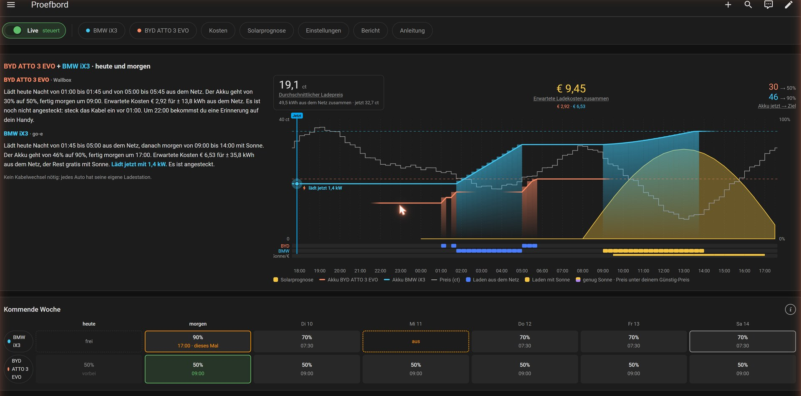

# HESC v4 · Beta — Kurzanleitung

*English: [README.md](README.md) · Nederlands: [README.nl.md](README.nl.md)*

HESC lädt dein Elektroauto so viel wie möglich mit deinem eigenen Solarstrom und, wenn die Sonne nicht
reicht, aus dem Netz zu den günstigsten Zeiten. HESC v4 folgt auf HESC v3: einfacher einzurichten, mit
einem eigenen Panel in Home Assistant und mit **zwei Autos und zwei Wallboxen**.

> **Beta.** Dies ist die erste Beta. Die ausführliche Anleitung gibt es vorerst auf Englisch
> ([README.md](README.md)) und Niederländisch ([README.nl.md](README.nl.md)).

Das Panel folgt der Sprache deines Home-Assistant-Profils: Niederländisch, Deutsch, und Englisch für
jede andere Sprache.

## Installieren

1. Das Repository in HACS hinzufügen und **HESC v4** installieren. Home Assistant neu starten.
2. *Einstellungen → Geräte & Dienste → Integration hinzufügen → HESC v4*.
3. Eine Frage: **HESC v4 installieren?** Ist HESC v3 installiert, kannst du dessen Einstellungen übernehmen.
4. **HESC v4** erscheint in der Seitenleiste; dort beginnt der erste Start.

Nach der Installation ist HESC im **Schattenmodus**: HESC rechnet und zeigt, was es tun würde, schaltet
aber nichts.

## Ein oder zwei Autos, eine oder zwei Wallboxen

- **Ein Auto, eine Wallbox.** Der übliche Fall.
- **Zwei Autos, eine Wallbox.** HESC plant beide Autos: das erste vor der Uhrzeit, zu der du das Kabel
  umsteckst, das andere danach. Auf Wunsch kommt eine Erinnerung aufs Handy.
- **Zwei Autos, zwei Wallboxen.** Jedes Auto hat seine eigene Wallbox; gleiche oder andere Marke.

## Planung

- **Rhythmus** — eine Standard-Abfahrtszeit und ein Ladeziel in %, pro Wochentag an oder aus.
- **Nur dieses Mal** — das nächste Mal überspringen, andere Zeit oder %, oder **jetzt laden**.
- **Kalender** — freie Tage, zusätzliche Tage und Urlaub.
- **Jetzt laden ist geschützt.** HESC lädt erst nach **Start** und Bestätigung aus dem Netz. Stoppen
  geht immer.

## Kosten, Prognose und Bericht

- **Kosten** — was das Laden pro Tag, Woche, Monat und Jahr gekostet hat, aus Sonne und Netz; pro Auto.
  Als CSV herunterladen ist möglich.
- **Solarprognose** — erwartete gegen tatsächliche Sonne, und wann das Auto mit Sonne laden kann.
- **Bericht** — wie das Laden mit Sonne lief, und sichern oder teilen.

Bildschirmfotos: Testboard mit Demodaten (erfundene Autos, Preise und Ladeverlauf). Mehr:
[docs/images/v4/de](docs/images/v4/de/).
