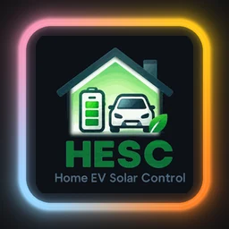
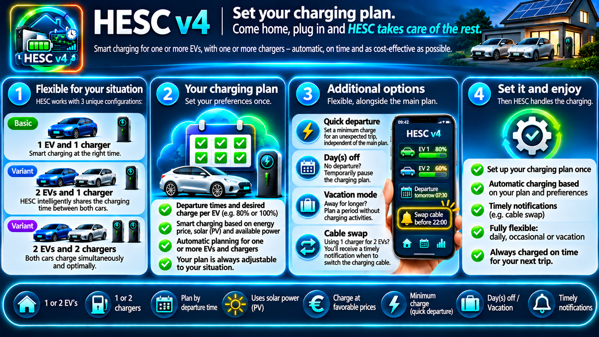
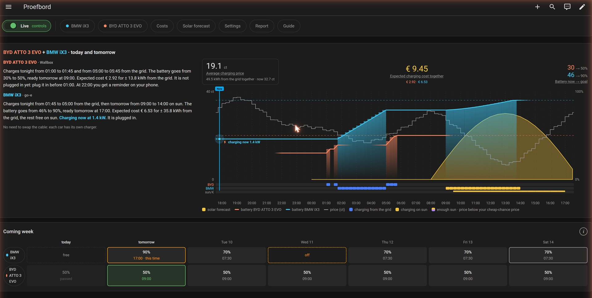

   

# HESC v4 — Smart EV Charging Management

*Set your plan. Plug in. HESC takes care of the rest.*

*Nederlands: [README.nl.md](README.nl.md) · Deutsch: [README.de.md](README.de.md)*

HESC charges your electric car with your own solar power as much as it can, and from the grid at
the cheapest moments when the sun is not enough. HESC v4 follows HESC v3: easier to set up, with its
own panel in Home Assistant and with **two cars and two chargers**.

> **Beta.** This is the first beta. See [Not ready yet](#not-ready-yet).

The panel follows the language of your Home Assistant profile: Dutch, German, and English for every other language.

## 1. Install

1. Add the repository in HACS and install **HESC v4**. Restart Home Assistant.
2. *Settings → Devices & services → Add integration → HESC v4*.
3. One question: **Install HESC v4?** With HESC v3 installed you can take over v3's settings.
4. **HESC v4** appears in the sidebar; the first start begins there.

After installing, HESC is in **shadow mode**: it calculates and shows what it would do, but switches
nothing. Shadow mode can only be switched off once the first start is done.

## 2. The first start

First a few questions, then only what HESC did not find itself.

1. **How do you charge at home?** One car · two cars on one charger · two cars, each its own charger.
2. **Your house.** Connection (1 or 3 phases, amps), load balancer, solar panels, dynamic prices, and
   the confirmation that your installation can take the charging.
3. **Charger.** Pick the brand. With two chargers of the same brand you choose which is which.
4. **Car.** Name, colour and battery capacity (the latter only when the car does not report it).
5. **What HESC did not find**, for example the battery-level sensor or the prices.

With a Wallbox and one car this is about 9 taps.

## 3. What HESC finds, what you fill in

| Part | Plug and play | You fill in |
|---|---|---|
| Charger | Wallbox, Peblar, Alfen, go-e, Wattpilot, SMA, evcc, Ohme | Zappi and Easee ask a little more; *Other* all by hand |
| Solar power, smart meter | usually found; HESC makes a **suggestion** | when the suggestion is wrong |
| Solar forecast | Solcast and other forecasts are found | — |
| Prices | Grid Clock, EnergyZero/ANWB, EasyEnergy, Tibber, Nord Pool | *Price list in a sensor*: pick the sensor |
| Battery capacity | when the car reports it | otherwise you type it |
| Home battery | HESC makes a suggestion | always your choice (per battery, or one total sensor) |
| Weather station | — | switch it on and pick the sensor |

Every setting has a small **(i)** with one or two sentences of explanation.

## 4. One or two cars, one or two chargers

- **One car, one charger.** The usual case.
- **Two cars, one charger.** HESC plans both cars: the first before the time you set to move the cable,
  the other after. The overview says when to swap; a reminder on your phone is possible (*Settings › Standard ›
  Move the cable*).
- **Two cars, two chargers.** Each car has its own charger; same brand or different.

Adding and removing: *Settings › Basis › Auto's en laadpalen*.
- **+ Add car** — a second car, on the same charger or with its own.
- **+ Add charger** — when two cars share one charger, car 2 gets its own charger.
- **Remove** — only car 2 and charger 2. HESC first shows what will go and asks for confirmation.
  Charging costs and history are not deleted but kept.

## 5. The panel

A row of buttons at the top: **Live · stuurt** (shadow mode), the planning per car, **Kosten** (costs),
**Zonverwachting** (solar forecast), **Instellingen** (settings), **Rapport** (report) and **Uitleg** (help).

**Today and tomorrow** — on the left a short letter per car (when it charges, from sun or grid, to what %
and the cost), on the right the chart with forecast, price and the charging moments per car.
**Coming week** — per car the next seven days; tap a car or a day to open its planning.

## 6. Planning

- **Rhythm** — a default ready time and battery %, per weekday on or off, or with its own time or %.
- **Only this time** — skip the next time, another time or %, or **charge now**.
- **Calendar** — single days off or extra, and holidays (drag from the first to the last day).
- **Not plugged in** — a reminder when the car is not plugged in in the evening.

**Charge now is protected.** The arrows only choose the goal. HESC charges from the grid only after
**Start** and the confirmation. Stopping is always possible.

## 7. Settings

Three tabs: **Basis** (charger, car(s), prices, HESC on/off, cars and chargers; the **⏻** tag of a car
switches HESC on or off for that car), **Standaard** (tiles: charger, solar and grid, home battery,
notifications, back-up, cheap chances) and **Expert** (tiles for fine tuning; what you change often
is on the tile itself). A tile shows ✓ when all is fine or ⚠ with what is missing.

Picking a sensor: tap the field for a short list with the current choice and HESC's **suggestion** on
top. The charger's modes for *charging on sun* and *no car* are ticked, not typed.

## 8. HESC on, off and shadow

| Switch | What it does |
|---|---|
| **HESC staat aan** (Basis) | Main switch. Off = HESC does nothing. |
| **Schaduwmodus** (Basis and *Live · stuurt*) | HESC calculates and shows what it would do, but controls nothing. |
| **⏻ per car** (Basis, at the car) | Off = HESC still plans that car but does not control it or its own charger. The other car carries on. |

## 9. Costs, forecast and report

- **Kosten** — what charging cost per day, week, month and year, from sun and grid; per car with two
  cars. *Export charging costs* writes two CSV files to the hesc_v4 folder; *Download charging costs* gives them to you.
- **Zonverwachting** — expected sun against actual, and when the car can charge on sun.
- **Rapport** — the **charging report** (how charging on sun went, per day, with advice), and
  **keep or share**: full back-up, anonymous to share, or short for a bug report.

## Not ready yet

- In English and German some texts may still need polishing; names of your own devices come from Home Assistant.

Screenshots: test board with demo data (invented cars, prices and charging history). More: [planning](docs/images/v4/en/en-02-planning.jpg),
[costs](docs/images/v4/en/en-03-costs.jpg), [solar forecast](docs/images/v4/en/en-04-solar-forecast.jpg),
[settings › basic](docs/images/v4/en/en-05-settings-basic.jpg), [settings › standard](docs/images/v4/en/en-06-settings-standard.jpg);
German: [docs/images/v4/de](docs/images/v4/de/); Dutch: [docs/images/v4/nl](docs/images/v4/nl/).

## Support this project

Find HESC useful? Give it a ⭐ on GitHub, so others can find it too.

Want to do a little more? Support me on [Ko-fi](https://ko-fi.com/satscan).

## License

[GPL-3.0](LICENSE)
